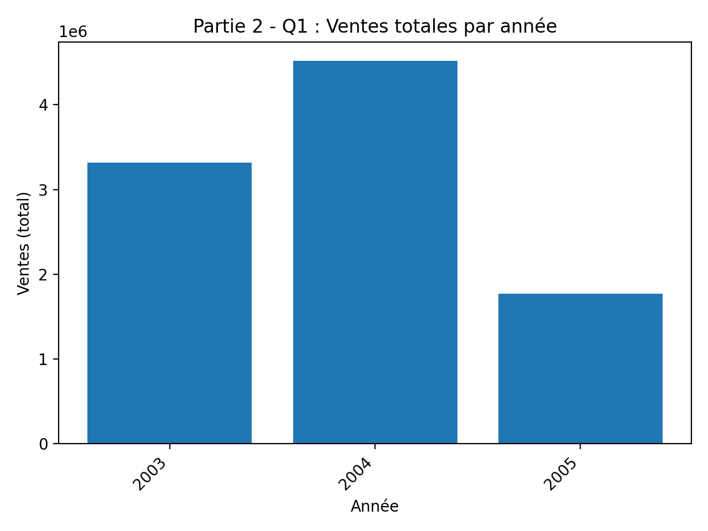
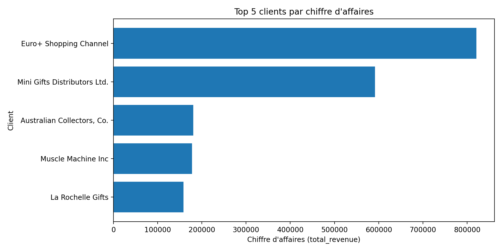
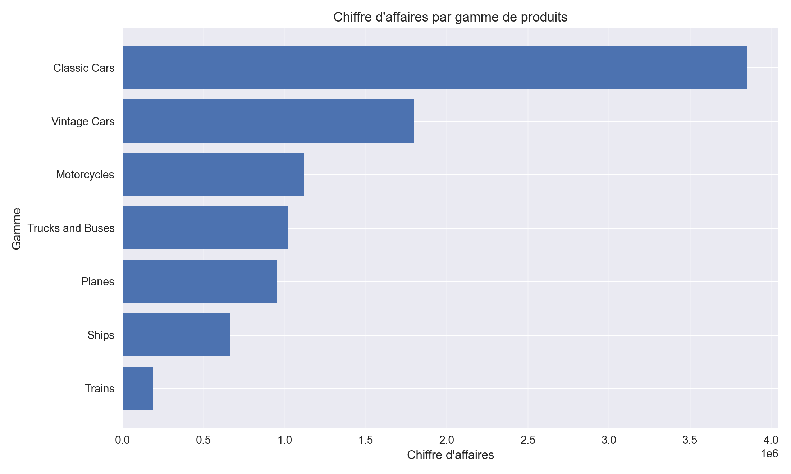
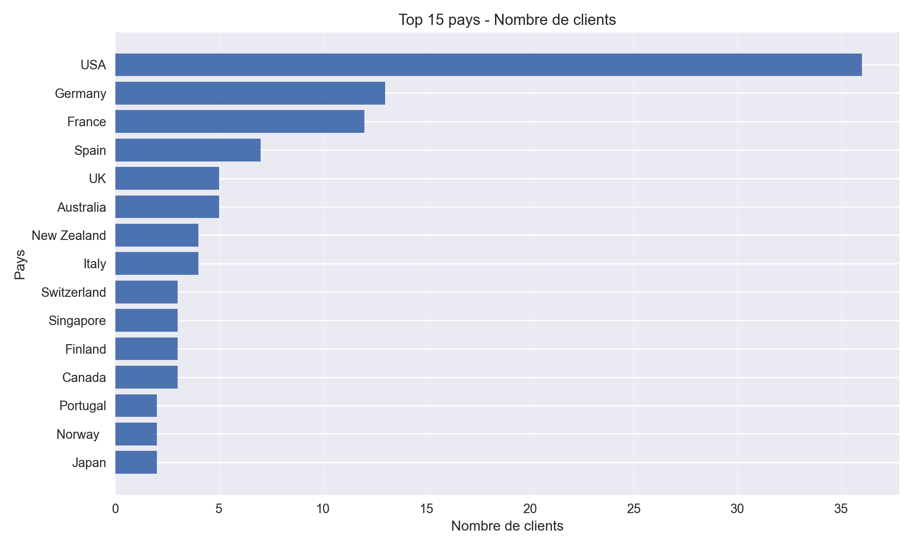
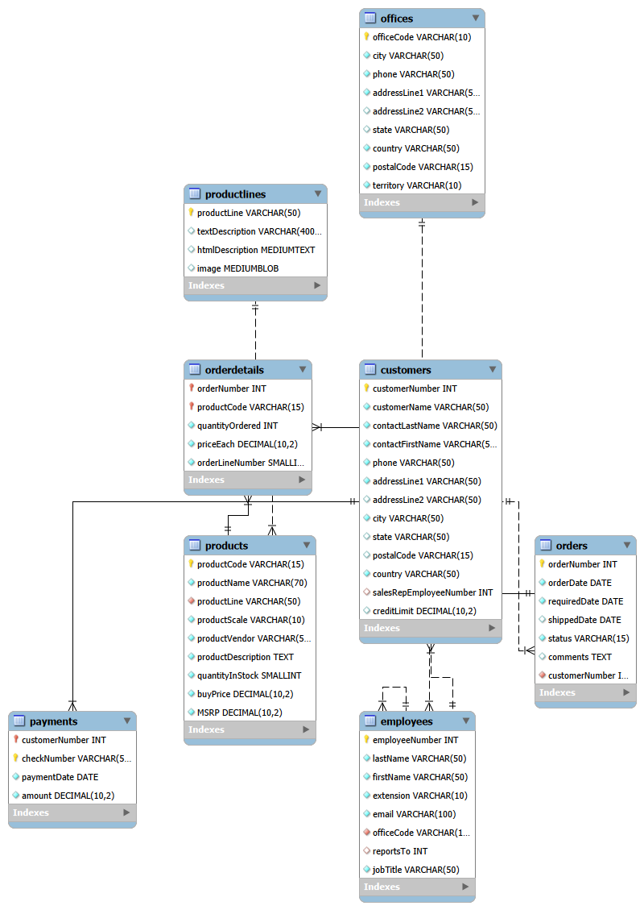
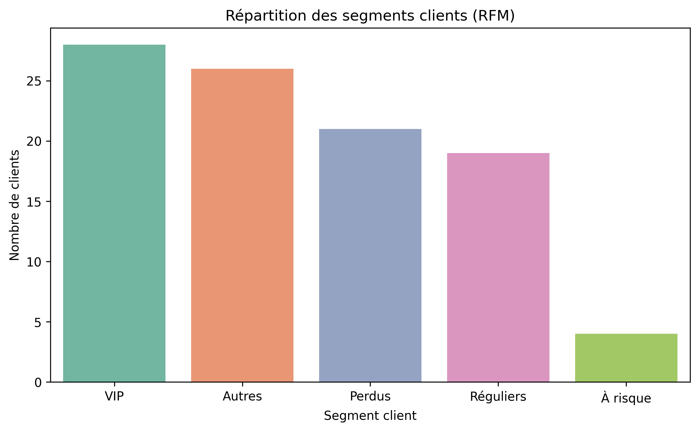
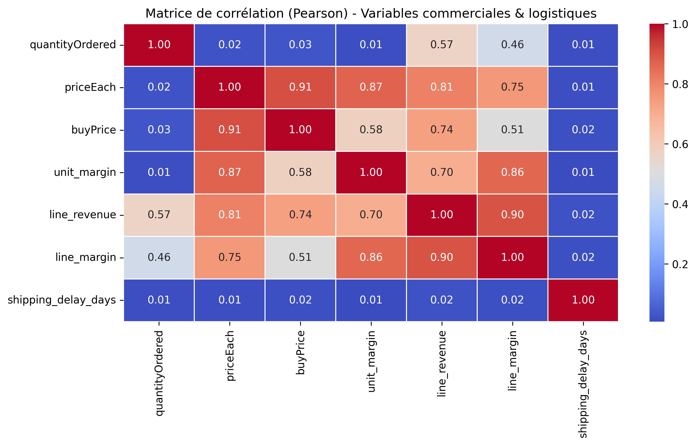
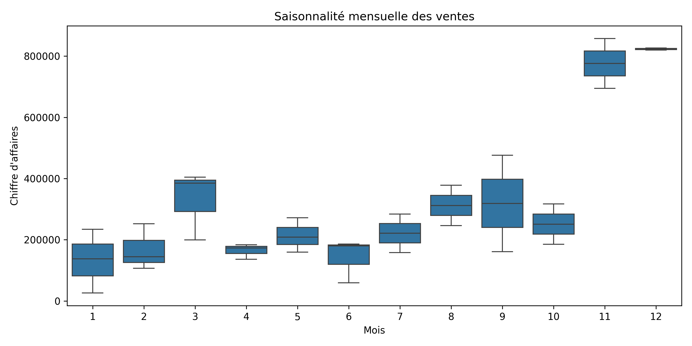
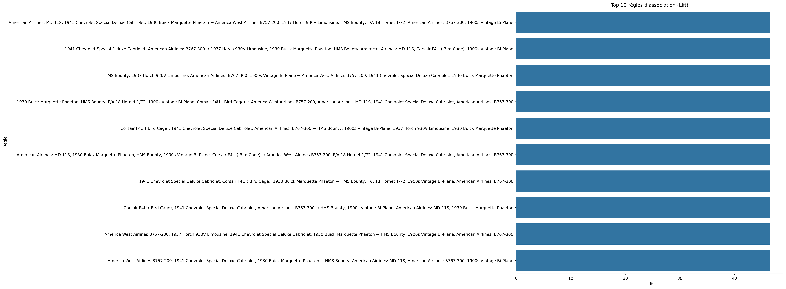

<div align="center">

# ClassicModels — Analyse commerciale
### SQL · Python · Business Intelligence · Analyses avancées

**Une étude de données commerciales de bout en bout : exploration SQL, analyse des ventes, segmentation clients, saisonnalité et visualisations métier.**

    

</div>

---

## Présentation du projet

**ClassicModels** est une base de données d'exemple décrivant l'activité commerciale d'un distributeur de modèles réduits. Ce projet l'utilise pour explorer les ventes, les clients, les produits, les commandes et les performances commerciales.

L'approche combine **requêtes SQL**, **traitements Python**, **visualisations statiques et interactives** ainsi que des méthodes analytiques plus avancées.

> **Périmètre :** données d'exemple ClassicModels. Les graphiques représentent des analyses réalisées sur ce jeu de données et ne décrivent pas les performances d'une entreprise réelle.

## Tableau de bord — Aperçu des analyses

| Évolution annuelle des ventes | Meilleurs clients |
|---|---|
|  |  |
| Ventes par gamme de produits | Répartition des clients par pays |
|  |  |

## Architecture de la base de données



Le modèle relationnel permet d'étudier plusieurs dimensions de l'activité : **clients, employés, commandes, paiements, produits et gammes de produits**.

## Les quatre volets du projet

| Volet | Contenu | Livrables |
|---|---|---|
| **01 — Exploration commerciale** | Clients, produits, commandes et chiffre d'affaires | [Requêtes SQL](database/queries/part1_exploration.sql) · [Graphiques](visualizations/part1/) |
| **02 — Analyse SQL avancée** | Évolution des ventes, comparaisons temporelles, clients VIP | [Requêtes SQL](database/queries/part2_advanced.sql) · [Graphiques](visualizations/part2/) |
| **03 — Visualisations interactives** | Suivi des ventes, répartition géographique, produits, stocks | [Graphiques HTML et PNG](visualizations/part3/) |
| **04 — Analyses avancées** | RFM, corrélations, séries temporelles, paniers d'achat, employés | [Notebooks Jupyter](notebooks/part4_advanced_analysis/) · [Graphiques](visualizations/part4/) |

## Zoom sur les analyses avancées

### Segmentation RFM



L'analyse **RFM** (Récence, Fréquence, Montant) sert à segmenter les clients selon leurs comportements d'achat.

### Corrélations et saisonnalité

| Corrélations entre variables | Saisonnalité des ventes |
|---|---|
|  |  |

### Analyse des associations entre produits



Ce volet examine les associations entre produits dans les commandes. Une règle d'association révèle une cooccurrence statistique et ne démontre pas de relation causale.

## Pipeline analytique

`Base ClassicModels → Requêtes SQL → Extraction et traitement Python → KPI et analyses → Visualisations → Interprétation métier`

## Organisation du dépôt

```text
classicmodels-analysis/
├── config/                # Exemple de configuration
├── database/
│   ├── ddl/               # Préparation SQL
│   ├── queries/           # Analyses SQL
│   └── schema/            # Modèle EER
├── src/
│   └── analysis/          # Scripts Python
├── notebooks/
│   └── part4_advanced_analysis/
├── visualizations/
│   ├── part1/             # Exploration
│   ├── part2/             # SQL avancé
│   ├── part3/             # Graphiques interactifs
│   └── part4/             # Analyses avancées
├── requirements.txt
└── Rapport  sur Classic Models.pdf
```

## Exécuter le projet

**Prérequis :** Python, un serveur MySQL avec une base ClassicModels chargée et un environnement Jupyter pour les notebooks.

1. Cloner le dépôt et installer les dépendances :

```bash
git clone https://github.com/NacPKZ/classicmodels-analysis.git
cd classicmodels-analysis
python -m pip install -r requirements.txt
```

2. Configurer l'accès à la base de données en s'appuyant sur [`config/.env.example`](config/.env.example), sans publier d'identifiants.
3. Explorer les [requêtes SQL](database/queries/) et les [scripts d'analyse Python](src/analysis/).
4. Ouvrir les [notebooks d'analyses avancées](notebooks/part4_advanced_analysis/) avec Jupyter.

**Reproductibilité :** l'exécution nécessite une base ClassicModels accessible et une configuration locale adaptée. Le fichier `requirements.txt` recense l'environnement du projet, avec davantage de bibliothèques que les seules dépendances indispensables.

## Technologies et compétences mobilisées

**MySQL · SQL avancé · Python · Pandas · Jupyter · Matplotlib · Plotly · Analyse RFM · Corrélations · Séries temporelles · Market Basket Analysis · Business Intelligence**

## Rapport et livrables

- [Rapport complet au format PDF](Rapport%20%20sur%20Classic%20Models.pdf)
- [Visualisations interactives et statiques](visualizations/)
- [Notebooks d'analyse avancée](notebooks/part4_advanced_analysis/)
- [Requêtes SQL](database/queries/)

---

<div align="center">

**Projet d'analyse de données et d'aide à la décision**

[Profil GitHub](https://github.com/NacPKZ)

</div>
